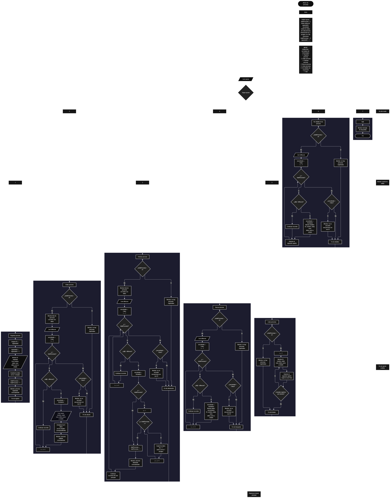

 

Este proyecto, llamado <b>alturas de personas</b>, fue desarrollado en <b>pseint</b> como un ejercicio práctico para fortalecer la lógica de programación mediante la creación de un sistema de gestión de personas desde la consola. El programa cuenta con un menú principal de siete opciones que permite <b>registrar, editar, eliminar, buscar, listar y consultar los detalles</b> de las personas registradas, además de finalizar la ejecución. Cada persona almacena datos como el nombre, la edad, el sexo, la altura en metros, el peso en kilogramos y el estado, utilizando siete arreglos con una capacidad definida de <b>100 posiciones</b>. Durante su desarrollo se aplicaron conceptos fundamentales de programación, como variables, arreglos, estructuras condicionales, ciclos repetitivos y estructuras de selección, además de procesos para buscar, modificar, eliminar y reorganizar registros. Este proyecto permite poner en práctica los conocimientos adquiridos en PSeInt y sirve como base para desarrollar sistemas de gestión más avanzados utilizando otros lenguajes y tecnologías.

<h2 align="center">⚙️ Funcionamiento del menú principal</h2>

### ➕ Registrar persona

La opción <b>1) registrar persona</b> permite agregar una nueva persona al sistema. Para comenzar, el programa asigna un identificador utilizando la variable <b>siguienteID</b>, almacena ese valor en el arreglo <b>id</b> y aumenta el identificador para el siguiente registro. Después, solicita el <b>nombre, edad, sexo, altura, peso y estado</b>, almacenando cada dato en la posición correspondiente de su respectivo arreglo. Una vez ingresada la información, incrementa la variable <b>totalPersonas</b> en uno y muestra el mensaje <b>"persona registrada correctamente."</b>. Los arreglos tienen 100 posiciones, aunque el código actual no incluye una validación que impida registrar personas cuando se alcanza esa capacidad.

### ✏️ Editar persona

La opción <b>2) editar persona</b> permite modificar los datos de una persona registrada mediante su identificador. Primero, el programa comprueba si la variable <b>totalPersonas</b> es igual a <b>0</b>. Si no existen registros, muestra el mensaje <b>"no hay personas registradas."</b>. En caso contrario, presenta una lista con el ID, nombre, edad, sexo, altura, peso y estado de cada persona. Después, solicita el ID de la persona que se desea editar e inicializa la variable lógica <b>encontrado</b> con el valor <b>falso</b>. Mediante un ciclo <b>para</b>, recorre los identificadores almacenados y los compara con el valor introducido. Si encuentra una coincidencia, cambia <b>encontrado</b> a <b>verdadero</b>, solicita los nuevos datos y actualiza los valores de los arreglos correspondientes. Finalmente, muestra el mensaje <b>"persona editada correctamente."</b>. Si no encuentra el identificador solicitado, muestra un mensaje indicando que no se encontró una persona con ese ID.

### 🗑️ Eliminar persona

La opción <b>3) eliminar persona</b> permite eliminar un registro utilizando el ID de la persona. Antes de realizar la operación, el programa comprueba si existen personas registradas. Si no hay registros, muestra el mensaje <b>"no hay personas registradas."</b>. Si existen personas, presenta sus datos y solicita el identificador que se desea eliminar. Después, inicializa la variable <b>encontrado</b> con el valor <b>falso</b> y recorre los identificadores mediante un ciclo <b>para</b>. Cuando encuentra una coincidencia, cambia la variable a <b>verdadero</b>. Si la persona no ocupa la última posición, utiliza otro ciclo <b>para</b>, controlado por la variable <b>j</b>, para desplazar una posición hacia la izquierda los datos posteriores en los siete arreglos: <b>id, nombre, edad, sexo, altura, peso y estado</b>. Posteriormente, disminuye <b>totalPersonas</b> en uno y muestra el mensaje <b>"persona eliminada correctamente."</b>. Si no encuentra el ID, informa que no existe una persona con ese identificador. El código no limpia expresamente la última posición después de eliminar un registro, sino que deja de considerarla activa al reducir el contador.

### 🔎 Buscar persona

La opción <b>4) buscar persona</b> permite localizar un registro mediante su identificador. Primero, el programa comprueba si existen personas registradas. Si la variable <b>totalPersonas</b> es igual a <b>0</b>, muestra el mensaje <b>"no hay personas registradas."</b>. En caso contrario, solicita el ID que se desea buscar e inicializa la variable lógica <b>encontrado</b> con el valor <b>falso</b>. A continuación, utiliza un ciclo <b>para</b> para recorrer los identificadores y compararlos con el valor introducido. Cuando encuentra una coincidencia, cambia la variable a <b>verdadero</b>, muestra el mensaje <b>"datos encontrados"</b> y presenta el ID, nombre, edad, sexo, altura, peso y estado de la persona. Si termina el recorrido sin encontrar coincidencias, muestra un mensaje indicando que no se encontró una persona con ese ID.

### 📋 Listar personas

La opción <b>5) listar personas</b> permite visualizar todos los registros activos del sistema. Antes de mostrar los datos, el programa comprueba si existen personas registradas mediante la variable <b>totalPersonas</b>. Si su valor es igual a <b>0</b>, muestra el mensaje <b>"no hay personas registradas."</b>. Si existen registros, presenta el mensaje <b>"datos registrados"</b> y utiliza un ciclo <b>para</b> para recorrer las posiciones comprendidas entre <b>1</b> y <b>totalPersonas</b>. En cada repetición, muestra el ID, nombre, edad, sexo, altura, peso y estado de la persona. Esta opción facilita consultar todos los registros almacenados sin necesidad de buscar cada persona individualmente.

### 📄 Ver detalles de la persona

La opción <b>6) ver detalles de la persona</b> permite consultar individualmente la información de una persona específica. Primero, el programa verifica si existen registros. Si no hay personas registradas, muestra el mensaje <b>"no hay personas registradas."</b>. De lo contrario, solicita el ID de la persona que se desea consultar e inicializa la variable <b>encontrado</b> con el valor <b>falso</b>. Después, recorre el arreglo <b>id</b> mediante un ciclo <b>para</b>. Si encuentra una coincidencia, cambia la variable a <b>verdadero</b> y muestra los detalles por separado: <b>ID, nombre, edad, sexo, altura, peso y estado</b>. Si finaliza el recorrido sin localizar el identificador, informa que no se encontró una persona con ese ID.

### 🚪 Salir del menú principal

La opción <b>7) salir</b> permite finalizar la ejecución del sistema. Cuando el usuario selecciona esta opción, el programa muestra el mensaje <b>"gracias por utilizar el sistema de alturas de personas."</b>. El menú principal está dentro de una estructura repetitiva <b>repetir ... hasta que</b>, cuya condición final es <b>opcion = 7</b>. Por lo tanto, cuando se selecciona la opción 7, el ciclo termina y el programa finaliza correctamente.

<h2 align="center">🧠 Temas aplicados en el proyecto</h2>

### 📦 Variables

En este proyecto se utilizan variables para controlar las opciones del menú, contar las personas registradas, generar identificadores consecutivos, recorrer los arreglos, almacenar el ID que se desea buscar y comprobar si una persona fue encontrada. También se emplean variables para almacenar temporalmente los datos de cada persona mediante los arreglos correspondientes. Cada variable cumple una función específica dentro de las operaciones de registro, edición, eliminación, búsqueda, listado y consulta de detalles.

🔢 **Opcion:** Almacena la opción seleccionada por el usuario en el menú principal.

📊 **TotalPersonas:** Controla la cantidad actual de personas registradas.

🔄 **I:** Funciona como contador en los ciclos `para` utilizados para recorrer los arreglos.

🔁 **J:** Controla el desplazamiento de los datos durante la eliminación de una persona.

🔎 **IdBuscar:** Almacena el identificador de la persona que se desea editar, eliminar, buscar o consultar.

🆔 **SiguienteID:** Genera identificadores consecutivos para los nuevos registros.

✅ **Encontrado:** Variable lógica que indica si se localizó una persona con el ID solicitado.

### 🗃️ Arreglos

El sistema utiliza siete arreglos, cada uno con una capacidad definida de <b>100 posiciones</b>. Estos arreglos almacenan los datos de las personas de forma coordinada, utilizando el mismo índice para relacionar la información de un registro. Por ejemplo, los datos de la primera persona se encuentran distribuidos entre <b>id[1], nombre[1], edad[1], sexo[1], altura[1], peso[1] y estado[1]</b>. Esta organización permite recorrer, consultar, modificar y eliminar registros mediante sus posiciones correspondientes. La variable <b>totalPersonas</b> determina cuántas posiciones se consideran ocupadas durante la ejecución.

🆔 **Id[100]:** Almacena los identificadores de las personas registradas.

📝 **Nombre[100]:** Almacena los nombres de las personas.

🎂 **Edad[100]:** Almacena las edades de las personas.

👤 **Sexo[100]:** Almacena el sexo registrado para cada persona.

📏 **Altura[100]:** Almacena las alturas expresadas en metros.

⚖️ **Peso[100]:** Almacena los pesos expresados en kilogramos.

📌 **Estado[100]:** Almacena el estado de cada persona.

### 🔀 Estructuras condicionales

Las estructuras <b>si</b> y <b>sino</b> permiten comprobar si existen personas registradas antes de realizar las operaciones de edición, eliminación, búsqueda, listado y consulta de detalles. También se utilizan para comparar el ID introducido con los identificadores almacenados, determinar si una persona fue encontrada y decidir si es necesario desplazar los datos al eliminar un registro. Estas condiciones permiten ejecutar diferentes instrucciones según los resultados obtenidos durante cada operación.

### 🔄 Estructuras repetitivas

El programa utiliza los ciclos <b>para</b> y <b>repetir ... hasta que</b>. Los ciclos <b>para</b> permiten recorrer los arreglos para mostrar las personas registradas, buscar un identificador y acceder a los datos correspondientes. Durante la eliminación, se utiliza un ciclo adicional para desplazar los elementos posteriores una posición hacia la izquierda. Por otro lado, el ciclo <b>repetir ... hasta que</b> mantiene activo el menú principal y permite realizar distintas operaciones hasta que el usuario selecciona la opción <b>7</b>.

### 🎯 Estructura según

La estructura <b>según</b> evalúa el valor almacenado en la variable <b>opcion</b> y ejecuta las instrucciones correspondientes a cada alternativa del menú. Los casos del 1 al 7 representan el registro, la edición, la eliminación, la búsqueda, el listado, la consulta de detalles y la salida del sistema. Además, el bloque <b>de otro modo</b> muestra un mensaje de opción no válida cuando el usuario introduce un valor que no coincide con las alternativas definidas.

### 🔢 Dimensionamiento de arreglos

El programa utiliza la instrucción <b>dimension</b> para definir siete arreglos con <b>100 posiciones</b> cada uno. Esta capacidad permite organizar los datos de las personas en posiciones relacionadas. La variable <b>totalPersonas</b> controla la cantidad de registros activos, mientras que <b>siguienteID</b> permite asignar identificadores consecutivos. El código actual no incluye una condición que compruebe si los arreglos han alcanzado su capacidad máxima antes de registrar una nueva persona.

### 🔄 Reorganización de registros

La reorganización se realiza durante la eliminación de una persona. Cuando el registro encontrado no se encuentra en la última posición, el programa utiliza la variable <b>j</b> para recorrer las posiciones posteriores. En cada repetición, copia los valores de la posición <b>j + 1</b> a la posición <b>j</b> en los siete arreglos. Una vez terminado el desplazamiento, disminuye <b>totalPersonas</b> en uno. Así, los registros que permanecen activos quedan agrupados en las primeras posiciones de los arreglos, sin dejar un espacio intermedio en el listado lógico de personas.

<h2 align="center">¿Cómo se implementaron las operaciones CRUD en el proyecto?</h2>

Las operaciones <b>CRUD</b> se representan mediante las opciones del menú principal. La operación <b>crear</b> corresponde a <b>registrar persona</b>, donde se asigna un ID y se almacenan los datos introducidos. La operación <b>leer</b> se realiza mediante <b>buscar persona, listar personas y ver detalles de la persona</b>, que permiten consultar uno o varios registros. La operación <b>actualizar</b> corresponde a <b>editar persona</b>, donde se modifican los datos de un registro existente. Finalmente, la operación <b>eliminar</b> se implementa mediante <b>eliminar persona</b>, que desplaza los datos posteriores y reduce el contador de registros activos. Todas estas operaciones trabajan con los arreglos durante la ejecución del programa.

<h2 align="center">Diagrama de flujo del proyecto</h2>

<h2 align="center">🛡️ Validaciones del programa</h2>

### 📭 No existen personas registradas

Esta comprobación se utiliza en las opciones de <b>editar, eliminar, buscar, listar y ver detalles de la persona</b>. El programa verifica si <b>totalPersonas = 0</b>. Si no existen registros, muestra el mensaje <b>"no hay personas registradas."</b> y evita continuar con la operación que necesita esos datos. De esta manera, el programa contempla el caso en que el usuario intenta consultar o administrar una lista vacía.

### 🔎 Persona no encontrada

Esta comprobación se utiliza en las operaciones de <b>editar, eliminar, buscar y ver detalles</b>. Antes de recorrer los arreglos, el programa asigna el valor <b>falso</b> a la variable lógica <b>encontrado</b>. Cuando el ID coincide con uno de los identificadores almacenados, la variable cambia a <b>verdadero</b> y se ejecuta la operación correspondiente. Si al finalizar el recorrido permanece en <b>falso</b>, el programa muestra un mensaje indicando que no se encontró una persona con ese ID.

### ⚠️ Capacidad de los arreglos

Los siete arreglos están dimensionados para almacenar hasta <b>100 posiciones</b>. Sin embargo, el código actual no incorpora una validación que compruebe si <b>totalPersonas</b> es menor que <b>100</b> antes de registrar otra persona. Por ello, aunque la capacidad está definida, no existe un control explícito que impida superar el límite establecido. Esta validación podría incorporarse posteriormente para mejorar la seguridad del registro.

### 🔢 Identificadores consecutivos

La variable <b>siguienteID</b> comienza en <b>1</b> y aumenta en uno cada vez que se registra una persona. De esta forma, cada nuevo registro recibe un identificador consecutivo. Cuando se elimina una persona, el identificador eliminado no se reutiliza automáticamente, ya que el contador <b>siguienteID</b> no se reduce ni se reinicia durante la operación.

### ⚠️ Datos introducidos por el usuario

El programa solicita información para los campos nombre, edad, sexo, altura, peso y estado. Sin embargo, el código actual no incluye comprobaciones que restrinjan los valores introducidos según reglas específicas. Por ejemplo, no valida que la edad o el peso sean positivos, que la altura esté dentro de un rango determinado o que el sexo y el estado pertenezcan a opciones previamente definidas. Los datos se almacenan de acuerdo con el tipo declarado para cada variable o arreglo.

### 🔢 Opción inválida

La estructura <b>según</b> contiene un bloque <b>de otro modo</b> que muestra un mensaje de opción no válida cuando el valor introducido no coincide con ninguna de las opciones disponibles del menú. Esta alternativa permite informar al usuario cuando selecciona un número que no está contemplado en el sistema, mientras el ciclo principal continúa esperando una nueva selección.

<h2 align="center">🎯 Objetivo del proyecto</h2>

El objetivo principal de este proyecto es fortalecer la <b>lógica de programación</b> mediante el desarrollo de un sistema de gestión de personas en <b>pseint</b>. A través de su construcción se busca aplicar los conocimientos adquiridos sobre variables, arreglos, estructuras condicionales, ciclos repetitivos y estructuras de selección, integrándolos para resolver un problema de manera organizada. Además, el proyecto permite comprender cómo registrar, consultar, modificar y eliminar información, así como organizar datos relacionados mediante arreglos. Estos conocimientos constituyen una base para desarrollar sistemas de gestión más completos utilizando otros lenguajes de programación y tecnologías.

